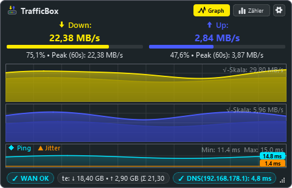

# TrafficBox

> Schlankes, plattformübergreifendes Live-Desktop-Widget (CachyOS / KDE Plasma & Windows) zur Echtzeit-Überwachung von Upload- und Download-Raten an Routern (wie AVM FRITZ!Box) per UPnP sowie optionaler Gäste-WLAN- und lokaler PC-Traffic-Analyse.

<p align="center">
  
  <br>
  <em>Live-Desktop-Widget mit Echtzeit-Graph, Upload/Download-Wellenform, Ping, Jitter & DNS-Monitor</em>
</p>

<p align="center">
  
  <br>
  <em>Kompakt-Modus („nur Zahlen“) für minimale Desktop-Beanspruchung</em>
</p>

<p align="center">
  
  <br>
  <em>Umfangreicher Einstellungs-Dialog mit Farb-Themes, Einheiten & Skalierungsmodi</em>
</p>

---

## 🛠️ Tech-Stack & Voraussetzungen

- **Sprache / Runtime:** Python 3.11+ (getestet mit Python 3.12)
- **GUI-Framework:** PySide6 (Qt6) – native Darstellung unter KDE Plasma (Wayland/X11) und Windows
- **Netzwerk / Protokolle:** Python Standardbibliothek (`urllib`, `xml.etree`, `hashlib`) für UPnP SOAP (`WANCommonIFC1` über Port `49000`) & optional Fritz!OS Lua/TR-064 Online-Monitor

---

## 🚀 Installation & Setup

1. **Repository klonen:**
   ```bash
   git clone https://github.com/WhiteSephi/traffic-box.git
   cd traffic-box
   ```

2. **Umgebung & Abhängigkeiten einrichten:**
   - **Windows (PowerShell):**
     ```powershell
     python -m venv .venv
     .\.venv\Scripts\Activate.ps1
     pip install -r requirements.txt
     ```
   - **CachyOS / Arch Linux:**
     ```bash
     # Entweder über System-Paket (empfohlen unter KDE Plasma):
     sudo pacman -S pyside6
     # Oder in einer virtuellen Umgebung:
     python -m venv .venv
     source .venv/bin/activate
     pip install -r requirements.txt
     ```

3. **Konfiguration & Speicherort:**
   - **Standard-Speicherort:** Einstellungen werden automatisch im benutzerspezifischen Systemordner als `config.json` abgelegt:
     - Windows: `%APPDATA%\trafficbox\config.json`
     - Linux/CachyOS: `~/.config/trafficbox/config.json`
   - **Portabler Modus (z. B. USB-Stick):** Liegt im Projekt- bzw. Programmverzeichnis der Ordner `local/` und befindet sich darin eine `config.json`, liest und schreibt das Widget alle Einstellungen direkt dort hinein, ohne das Betriebssystem zu berühren.
   - **Umgebungsvariablen (optional):**
     ```bash
     cp .env.example .env
     ```
   *(Alle Einstellungen lassen sich bequem direkt über den Einstellungs-Dialog im Rechtsklick- bzw. System-Tray-Menü anpassen.)*

---

## 💻 Verwendung / Starten

- **Per Doppelklick / Starter-Skript:**
  - **Windows (ohne Konsolenfenster):** Doppelklick auf `start_windows.vbs`
  - **CachyOS / Linux:** `./start_linux.sh` (nach `chmod +x start_linux.sh`)
- **Über das Terminal:**
  ```bash
  python -m src.main
  ```
- **Bedienung im Widget:**
  - **Ziehen mit linker Maustaste:** Widget frei auf dem Desktop positionieren (sofern Position nicht gesperrt ist).
  - **Doppelklick / Rechtsklick:** Öffnet die **Einstellungen** bzw. das Schnellmenü (UI-Skalierung für HiDPI-Displays, Graph-Skalierungsmodi, Bit/Byte-Umschaltung, Kompakt-Modus, Nur-Graph-Modus, Immer im Vordergrund, Position sperren).

---

## 🔒 Datenschutz, Sicherheit & Netzwerkverbindungen

- **100 % lokal & keine Telemetrie:** TrafficBox überträgt weder Traffic-Werte noch Gerätenamen, Zugangsdaten oder Nutzungsstatistiken an Dritte oder eigene Server. Alle Auswertungen laufen ausschließlich lokal auf deinem Rechner.
- **Ausgehende Diagnose-Verbindungen (optional abschaltbar unter `Einstellungen → Netzwerk`):**

  | Ziel | Intervall | Zweck | Abschaltbar über |
  |---|---|---|---|
  | `1.1.1.1` *(konfigurierbar)* | `1 s` | ICMP-Echo (Fallback TCP `443`/`53`) für Live-Ping & Jitter | `Ping- & Jitter-Graph anzeigen` |
  | Aktiver System-DNS *(Anfrage an `cloudflare.com` bzw. `tb-<nonce>.tbcheck.cloudflare.com`)* | `30 s` *(bzw. `1 s` ohne Uncached-DNS)* | DNS-Antwortzeit, RCODE- & Hijack-Prüfung | `System-DNS überwachen` / `Uncached-DNS (Nonce) nutzen` |
  | `cp.cloudflare.com` & `connectivitycheck.gstatic.com` *(Kaltstart-Fallback: `1.1.1.1` / `8.8.8.8`)* | `30 s` *(`5 s` im Störungs-Burst)* | Dual-Stack HTTPS-`204`-Canary & Zombie-WAN-Erkennung | `Aktive Internet-Erreichbarkeit prüfen` |

  *Hinweis: Externe Gegenstellen sehen dabei technisch bedingt ausschließlich deine öffentliche IP-Adresse, das Abfrage-Intervall und den Standard-Header (`User-Agent: TrafficBox`), jedoch keinerlei persönliche oder lokale Netzwerkdaten.*

- **Schutz der FRITZ!Box-Zugangsdaten & Heim-Router-Bindung:**
  - Der Standardbetrieb über UPnP (`Port 49000`) funktioniert komplett **ohne Passwort**.
  - Der optionale Fritz!OS-Login (für Online-Zähler & Gäste-WLAN) nutzt ausschließlich **PBKDF2-SHA256 Challenge-Response (`login_sid.lua?version=2`, mit `1.000–100.000` Iterationen)** – das Passwort wird nie im Klartext über das Netzwerk gesendet und unsicheres MD5-Login ist standardmäßig blockiert.
  - Eine automatische **Heim-Router-Bindung per UDN** (fail-closed) verhindert, dass gespeicherte Zugangsdaten in fremden Netzen an eine fremde FRITZ!Box gesendet werden.
  - Die Speicherung erfolgt unter **Windows über Windows DPAPI (`CryptProtectData`)** an dein Benutzerkonto gebunden; unter **Linux** über **PBKDF2-HMAC-SHA256 + Encrypt-then-MAC (At-Rest-Obfuskation)** in Kombination mit restriktiven POSIX-Dateirechten (`0600` auf `config.json`, `0700` auf `~/.config/trafficbox`).
- **Hinweis zu Multi-PC-Sync (Syncthing / Cloud-Ordner):** Wenn du den Projektordner zwischen mehreren PCs synchronisierst, solltest du **keine** `local/config.json` (Portabel-Modus) im synchronisierten Ordner ablegen. Andernfalls überschreiben sich die geräte- bzw. benutzergebundenen DPAPI-/Obfuskations-Secrets gegenseitig und erzeugen Sync-Konflikte. Ohne `local/config.json` verwaltet jedes Gerät seine Konfiguration sauber getrennt in `%APPDATA%\trafficbox\config.json` bzw. `~/.config/trafficbox/config.json`.

---

## 🧪 Automatisierte Tests

Das Projekt verfügt über eine schlanke Unit-Testsuite auf Basis der Python-Standardbibliothek (`unittest`), die ohne zusätzliche Abhängigkeiten direkt ausgeführt werden kann:

```bash
# Alle Tests ausführen
python -m unittest discover -s tests -v
```

---

## 📂 Projektstruktur

```text
.
├── src/
│   ├── main.py                 # Einstiegspunkt der Anwendung
│   ├── config.py               # Konfigurations-Management & .env-Support
│   ├── autostart.py            # Cross-Platform Autostart (Windows Registry & Linux XDG)
│   ├── api/
│   │   ├── models.py           # Datenmodelle (TrafficSample, OnlineCounterStats, PeriodCounter)
│   │   ├── worker.py           # Hintergrund-Thread & Polling-Orchestrierung (QObject)
│   │   ├── upnp_client.py      # Passwortfreier UPnP-SOAP-Client (Port 49000)
│   │   ├── fritz_monitor.py    # Optionaler Fritz!OS-Client für Online-Zähler & Gäste-WLAN
│   │   ├── internet_health.py  # Mehrstufige Internet-Qualitäts-, Dual-Stack- & Zombie-WAN-Diagnose
│   │   ├── net_health.py       # Ping-, Jitter-, Uncached-DNS- & HTTPS-204-Canary-Probes
│   │   ├── local_traffic.py    # Lokaler PC-Traffic-Monitor (Windows iphlpapi & Linux /proc/net/dev)
│   │   └── crypto.py           # Passwort-Schutz (Windows DPAPI & Linux PBKDF2-HMAC At-Rest-Obfuskation + 0600-Rechte)
│   └── ui/
│       ├── widget.py           # Rahmenloses Haupt-Widget (Header, Prozentbalken, Footer)
│       ├── graph_canvas.py     # Custom Qt6-Graph mit Oszilloskop-Hover-HUD & Mehrschicht-Flächen
│       ├── health_dialog.py    # Klickbare Status-Pillen & Internet-Diagnose-Detailfenster mit Tipps
│       ├── online_counter_view.py # Integrierte Online-Zähler-Tabellenansicht
│       ├── settings_dlg.py     # Umfangreicher Einstellungs-Dialog (Tabs, Farb-Picker, Cooldowns)
│       ├── formatters.py       # Formatierungshelfer für Raten, Einheiten (SI-Dezimal/Binär) & Zeiten
│       ├── icons.py            # Vektorgrafiken & Icons (Pfeile, UI-Symbole)
│       └── tray.py             # System-Tray-Integration & Schnellzugriff-Menü
├── tests/                      # Automatisierte Unit-Tests (unittest)
│   ├── test_autostart.py       # Windows Registry, Linux XDG .desktop & KWin-Regeln
│   ├── test_compact_mode.py    # Kompakt-/Nur-Graph-Modus, Theme-Awareness, HTML-Escaping & UI-Skalierung
│   ├── test_config.py          # Konfiguration, Standardwerte & .env-Parser
│   ├── test_crypto.py          # Ver-/Entschlüsselung & Windows DPAPI Roundtrip
│   ├── test_edge_snapping.py   # Magnetisches Einrasten an Bildschirm- & Arbeitsbereichsrändern
│   ├── test_formatters.py      # Raten-, Datenvolumen- & Uptime-Formatierung
│   ├── test_fritz_monitor.py   # Fritz!OS PBKDF2/MD5-Login, Redirect-Schutz & Online-Zähler
│   ├── test_health_dialog.py   # Diagnose-Detailfenster, klickbare Pillen & Handlungstipps
│   ├── test_internet_health.py # 5-Stufen-Statuslogik, Quorum, Hysterese, Baseline & Zombie-WAN
│   ├── test_local_traffic.py   # Linux /proc/net/dev-Parsing & lokale Ratenberechnung
│   ├── test_net_health.py      # Ping-Regex, ICMP, DNS-RCODE/Hijack & HTTPS-204-Canaries
│   ├── test_settings_dlg.py    # Einstellungs-Dialog, Formulare, Themes & Tab-Reset
│   ├── test_upnp_client.py     # UPnP-Session-Tracking, UDN-Erkennung & 32-Bit-Überlaufschutz
│   ├── test_worker_fallback.py # Lokaler Traffic-Fallback & UPnP-Cooldown im Worker
│   └── test_worker_foreign_box.py # Schutz vor Fehl-Logins auf fremden FRITZ!Boxen (Roaming)
├── requirements.txt            # Python-Abhängigkeiten (PySide6)
├── .env.example                # Vorlage für Umgebungsvariablen
└── CHANGELOG.md                # Chronologische Änderungshistorie
```
