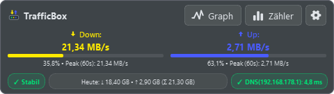
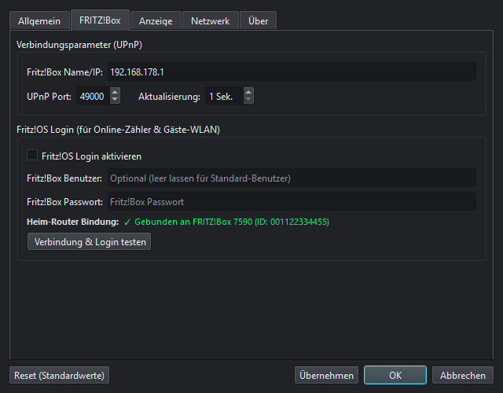

# TrafficBox

> Schlankes, plattformübergreifendes Live-Desktop-Widget (Windows & Linux / KDE Plasma) zur Echtzeit-Überwachung von Upload- und Download-Raten an Routern (wie AVM FRITZ!Box) per UPnP – inklusive Ping-/Jitter-Graph, Internet- & DNS-Statusprüfung, optionalem Online-Zähler, Gäste-WLAN- und lokalem PC-Traffic-Monitor.

<p align="center">
  
  <br>
  <em>Live-Desktop-Widget mit Echtzeit-Graph, Upload/Download-Wellenform, Ping, Jitter & DNS-Monitor</em>
</p>

<p align="center">
  
  <br>
  <em>Kompakt-Modus („nur Zahlen“) für minimale Desktop-Beanspruchung</em>
</p>

<p align="center">
  
  <br>
  <em>Umfangreicher Einstellungs-Dialog mit Farb-Themes, Einheiten, Skalierung & Diagnose</em>
</p>

---

## 💻 Systemanforderungen

- **Betriebssystem:**
  - **Windows:** Windows 10 / 11 (64-Bit)
  - **Linux:** Aktuelle Distribution mit KDE Plasma / X11 oder Wayland (getestet unter CachyOS / Arch Linux)
- **Windows (Standalone-Binary):** Keine Python-Installation erforderlich (~23 MB `TrafficBox.exe`, ca. 40–60 MB RAM im Betrieb)
- **Aus dem Quellcode (Linux & Windows):** Python **3.11+** (getestet mit Python 3.12) und **PySide6 ≥ 6.6.0**
- **Router / Netzwerk:** Router mit UPnP-Statusschnittstelle (`WANCommonIFC1` über Port `49000`, bei FRITZ!Box ab Werk aktiv) – oder automatischer Fallback auf den lokalen Netzwerkadapter des PCs

---

## 🚀 Installation & Schnellstart

### Windows (Empfohlen – ohne Python)

1. Lade die aktuelle **`TrafficBox.exe`** von den [GitHub Releases](https://github.com/WhiteSephi/traffic-box/releases/latest) herunter.
2. Lege die Datei in einen beliebigen Ordner (z. B. `C:\Tools\TrafficBox\`) und starte sie per Doppelklick.

> **Hinweis zu Windows SmartScreen:** Da `TrafficBox.exe` ein unsigniertes Open-Source-Binary ist, zeigt Windows beim allerersten Start eventuell eine SmartScreen-Meldung (*„Der PC wurde geschützt“*). Klicke auf **Weitere Informationen → Trotzdem ausführen**.
> Optional kannst du die Integrität vorab gegen die `SHA256SUMS.txt` aus dem Release prüfen:
> ```powershell
> Get-FileHash .\TrafficBox.exe -Algorithm SHA256
> ```

---

### Linux / CachyOS / Arch Linux (KDE Plasma)

```bash
git clone https://github.com/WhiteSephi/traffic-box.git
cd traffic-box

# PySide6 über das Systempaket installieren (empfohlen unter KDE Plasma):
sudo pacman -S pyside6

# Widget starten:
chmod +x start_linux.sh
./start_linux.sh
```

*(Für andere Distributionen oder eine isolierte Umgebung funktioniert ebenso `python -m venv .venv && source .venv/bin/activate && pip install -r requirements.txt && ./start_linux.sh`.)*

---

<details>
<summary><strong>Windows aus dem Quellcode starten (für Entwickler)</strong></summary>

```powershell
git clone https://github.com/WhiteSephi/traffic-box.git
cd traffic-box
python -m venv .venv
.\.venv\Scripts\Activate.ps1
pip install -r requirements.txt

# Start ohne Konsolenfenster (oder im Terminal via: python -m src.main):
wscript.exe .\start_windows.vbs
```

Optionales `.env`-Setup für Umgebungsvariablen:
```bash
cp .env.example .env
```

</details>

---

## ⚙️ Konfiguration & Bedienung

- **Standard-Speicherort der Einstellungen (`config.json`):**
  - **Windows:** `%APPDATA%\trafficbox\config.json`
  - **Linux:** `~/.config/trafficbox/config.json`
- **Portabler Modus (z. B. USB-Stick):** Liegt im Programmverzeichnis der Ordner `local/` und enthält eine `config.json`, speichert TrafficBox alle Einstellungen direkt dort, ohne das Benutzerprofil zu verändern.
- **Bedienung im Widget:**
  - **Linke Maustaste ziehen:** Widget frei auf dem Desktop platzieren (mit magnetischem Einrasten an Bildschirmrändern, sofern nicht gesperrt).
  - **Doppelklick / Rechtsklick / Tray-Icon:** Öffnet die **Einstellungen** bzw. das Schnellmenü (Themes, UI-Skalierung `70–300 %`, Graph-Skalierung, Bit/Byte, Kompakt-Modus, Nur-Graph-Modus, Online-Zähler, Autostart).
  - **Klick auf Status- oder DNS-Pille im Footer:** Öffnet das Live-Diagnosefenster mit detaillierter Status-Übersicht und Handlungstipps.

---

## 🔒 Datenschutz, Sicherheit & Netzwerkverbindungen

- **100 % lokal & keine Telemetrie:** TrafficBox überträgt weder Traffic-Werte noch Gerätenamen, Zugangsdaten oder Nutzungsstatistiken an Dritte oder eigene Server. Alle Auswertungen laufen ausschließlich lokal auf deinem Rechner.
- **Datensparsames Logging & Fehlerberichte:** Lokale Logs (`logs/trafficbox.log`, max. `3 × 1 MB`) sowie der optionale Bug-Report-Export unter `Einstellungen → Über` maskieren automatisch Benutzerpfade (`~`), nicht-standardmäßige IPv4-Adressen (`<IP>`) sowie Passwort-/Session-Parameter (`***`).
- **Ausgehende Diagnose-Verbindungen (optional abschaltbar unter `Einstellungen → Netzwerk`):**

  | Ziel | Intervall | Zweck | Abschaltbar über |
  |---|---|---|---|
  | `1.1.1.1` *(konfigurierbar)* | `1 s` | ICMP-Echo (Fallback TCP `443`/`53`) für Live-Ping & Jitter | `Ping- & Jitter-Graph anzeigen` |
  | Aktiver System-DNS *(Anfrage an `cloudflare.com` bzw. `tb-<nonce>.tbcheck.cloudflare.com`)* | `30 s` *(bzw. `1 s` ohne direkte DNS-Prüfung)* | DNS-Antwortzeit, RCODE- & Hijack-Prüfung | `System-DNS überwachen` / `Direkte DNS-Prüfung (ohne Cache)` |
  | `cp.cloudflare.com` & `connectivitycheck.gstatic.com` *(Kaltstart-Fallback: `1.1.1.1` / `8.8.8.8`)* | `30 s` *(`5 s` bei Störung)* | Dual-Stack HTTPS-`204`-Tests & Verbindungs-Check | `Aktive Internet-Erreichbarkeit prüfen` |

  *Hinweis: Externe Gegenstellen sehen dabei technisch bedingt ausschließlich deine öffentliche IP-Adresse, das Abfrage-Intervall und den Standard-Header (`User-Agent: TrafficBox`), jedoch keinerlei persönliche oder lokale Netzwerkdaten.*

- **Schutz der FRITZ!Box-Zugangsdaten & Heim-Router-Bindung:**
  - Der Standardbetrieb über UPnP (`Port 49000`) funktioniert komplett **ohne Passwort**.
  - Der optionale Fritz!OS-Login (für Online-Zähler & Gäste-WLAN) nutzt ausschließlich **PBKDF2-SHA256 Challenge-Response (`login_sid.lua?version=2`, mit `1.000–100.000` Iterationen)** – das Passwort wird nie im Klartext über das Netzwerk gesendet und unsicheres MD5-Login ist standardmäßig blockiert.
  - Eine automatische **Heim-Router-Bindung per UDN** (fail-closed) verhindert, dass gespeicherte Zugangsdaten in fremden Netzen an eine fremde FRITZ!Box gesendet werden.
  - Die Speicherung erfolgt unter **Windows über Windows DPAPI (`CryptProtectData`)** an dein Benutzerkonto gebunden; unter **Linux** über **PBKDF2-HMAC-SHA256 + Encrypt-then-MAC (At-Rest-Obfuskation)** in Kombination mit restriktiven POSIX-Dateirechten (`0600` auf `config.json`, `0700` auf `~/.config/trafficbox`).
- **Hinweis zu Multi-PC-Sync (Syncthing / Cloud-Ordner):** Wenn du den Projektordner zwischen mehreren PCs synchronisierst, solltest du **keine** `local/config.json` (Portabel-Modus) im synchronisierten Ordner ablegen, da geräte- bzw. benutzergebundene Secrets sonst zwischen Geräten überschrieben werden.

---

## 🧪 Automatisierte Tests & Build

Das Projekt verfügt über eine isolierte Unit-Testsuite auf Basis der Python-Standardbibliothek (`unittest`):

```bash
# Alle Tests ausführen
python -m unittest discover -s tests -v
```

Eigenen Windows-Standalone-Build erstellen:
```powershell
pip install pyinstaller
pyinstaller --clean --noconfirm TrafficBox.spec
```

---

## 📂 Projektstruktur

```text
.
├── .github/workflows/          # GitHub Actions (CI-Tests & automatischer Windows-Release-Build)
├── assets/                     # App-Icon (app_icon.ico) & Vorschau-Screenshots
├── src/
│   ├── main.py                 # Einstiegspunkt & CLI-Flags (--host, --debug, --self-test)
│   ├── config.py               # Konfigurations-Management, Validierung & .env-Support
│   ├── logger.py               # Rotating-File-Logging mit Privacy-Redaction & GitHub-Diagnose
│   ├── autostart.py            # Cross-Platform Autostart (Windows Registry & Linux XDG/KWin)
│   ├── api/
│   │   ├── models.py           # Datenmodelle (TrafficSample, OnlineCounterStats, HealthStatus)
│   │   ├── worker.py           # Hintergrund-Thread & Polling-Orchestrierung (QObject)
│   │   ├── upnp_client.py      # Passwortfreier UPnP-SOAP-Client (Port 49000)
│   │   ├── fritz_monitor.py    # Optionaler Fritz!OS-Client für Online-Zähler & Gäste-WLAN
│   │   ├── internet_health.py  # Mehrstufige Internet-Qualitäts-, Dual-Stack- & Verbindungsdiagnose
│   │   ├── net_health.py       # Ping-, Jitter-, Uncached-DNS- & HTTPS-204-Checks
│   │   ├── local_traffic.py    # Lokaler PC-Traffic-Monitor (Windows iphlpapi & Linux /proc/net/dev)
│   │   └── crypto.py           # Passwort-Schutz (Windows DPAPI & Linux PBKDF2-HMAC + 0600-Rechte)
│   └── ui/
│       ├── widget.py           # Rahmenloses Haupt-Widget (Header, Raten, Balken, Footer)
│       ├── widget_window.py    # Fenster-Interaktion, Edge-Snapping, VisualSizeGrip & Tray-Logik
│       ├── graph_canvas.py     # Custom Qt6-Graph mit Hover-HUD & Verlustmarkern
│       ├── health_dialog.py    # Klickbare Status-Pillen & Internet-Diagnose-Detailfenster
│       ├── online_counter_view.py # Integrierte Online-Zähler-Tabellenansicht
│       ├── settings_dlg.py     # Einstellungs-Dialog (Allgemein, FRITZ!Box, Anzeige, Netzwerk, Über)
│       ├── color_picker.py     # Modernes Color-Picker-Popover & kuratierte Farb-Themes
│       ├── formatters.py       # Formatierungshelfer für Raten, Einheiten & Zeiten
│       ├── icons.py            # Vektorgrafiken & UI-Icons
│       └── tray.py             # System-Tray-Integration & dynamische Status-LED
├── tests/                      # Automatisierte Unit-Tests (unittest)
│   ├── test_autostart.py       # Windows Registry, Linux XDG .desktop & KWin-Regeln
│   ├── test_compact_mode.py    # Kompakt-/Nur-Graph-Modus, Themes, HTML-Escaping & Skalierung
│   ├── test_config.py          # Konfiguration, Standardwerte & .env-Parser
│   ├── test_crypto.py          # Ver-/Entschlüsselung & Windows DPAPI Roundtrip
│   ├── test_edge_snapping.py   # Magnetisches Einrasten an Bildschirm- & Arbeitsbereichsrändern
│   ├── test_formatters.py      # Raten-, Datenvolumen- & Uptime-Formatierung
│   ├── test_fritz_monitor.py   # Fritz!OS PBKDF2/MD5-Login, Redirect-Schutz & Online-Zähler
│   ├── test_health_dialog.py   # Diagnose-Detailfenster, klickbare Pillen & Handlungstipps
│   ├── test_internet_health.py # 5-Stufen-Statuslogik, Quorum, Hysterese, Baseline & Ausfallerkennung
│   ├── test_local_traffic.py   # Linux /proc/net/dev-Parsing & lokale Ratenberechnung
│   ├── test_logger.py          # Privacy-Redaction, Diagnose-Bericht & Issue-URL-Generator
│   ├── test_net_health.py      # Ping-Regex, ICMP, DNS-RCODE/Hijack & HTTPS-204-Checks
│   ├── test_settings_dlg.py    # Einstellungs-Dialog, Formulare, Themes & Tab-Reset
│   ├── test_upnp_client.py     # UPnP-Session-Tracking, UDN-Erkennung & 32-Bit-Überlaufschutz
│   ├── test_worker_fallback.py # Lokaler Traffic-Fallback & UPnP-Cooldown im Worker
│   └── test_worker_foreign_box.py # Schutz vor Fehl-Logins auf fremden FRITZ!Boxen (Roaming)
├── TrafficBox.spec             # PyInstaller-Build-Konfiguration für Standalone-Binaries
├── start_windows.vbs           # Starter ohne Konsolenfenster für Windows (Source-Modus)
├── start_linux.sh              # Starter-Skript für Linux / CachyOS (XCB/Wayland)
├── requirements.txt            # Python-Abhängigkeiten (PySide6)
├── .env.example                # Vorlage für Umgebungsvariablen
├── LICENSE                     # MIT-Lizenz
└── CHANGELOG.md                # Chronologische Änderungshistorie
```

---

## 📄 Lizenz & rechtlicher Hinweis

- **Lizenz:** Dieses Projekt steht unter der [MIT-Lizenz](LICENSE).
- **Markenhinweis:** TrafficBox ist ein unabhängiges Open-Source-Projekt und **kein Produkt der FRITZ! GmbH (ehem. AVM)**. *FRITZ!* und *FRITZ!Box* sind eingetragene Marken der FRITZ! GmbH.
